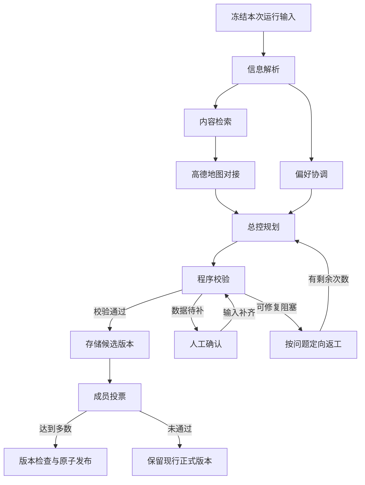

# 多人协同旅行规划平台工作流总体设计

第十三组 · 软件项目管理课程 · 设计草案 v0.1 · 2026-11-12

本设计说明如何将旅伴的预算与偏好转成可检查的多日行程，并在人工确认和多数投票后发布。设计以本组需求 v1.3 和六人开发分工为依据。仓库目前已提供 A 的旅行工作台与本地演示适配器。下文的运行、权限和发布规则供团队联调评审。

## 1 目标与范围

面向结伴旅行的大学生。成员加入同一房间后分别填写预算、必去地点、饮食限制和节奏偏好。显式发起规划时，服务将这些输入与攻略、地图和报价资料绑定至一次运行，形成带来源和费用明细的候选。成员可以比较候选和现行正式行程。

首轮规划演示验证单城市、含往返共一至三日、五种默认费用类别。团队联调增加多账号房间、五智能体、程序校验和投票发布。完整产品支持多城市、用户自定时长、自定义费用类别、实时群聊、个人云端历史和旅行记录。最终产品的普通聊天仅进入历史，成员通过 @助手或按钮发起助手任务。

## 2 设计规格与模块交接

| 模块 | 输入 | 输出与验收观察点 | 主责 |
| --- | --- | --- | --- |
| 旅行工作台 | 房间、个人偏好、版本清单 | 能建房、加入、保存、刷新恢复和切换方案 | A |
| 执行工作台 | 快照、节点、事件、门控 | 能定位失败、恢复显示、处理授权操作和投票 | B |
| 数据与权限 | 登录、房间操作、方案与投票写入 | 服务端鉴权，多账号数据隔离，持久化后可重读 | C |
| 调度 | 房间输入快照、节点依赖、控制命令 | 有界执行，记录尝试、错误及可恢复事件 | D |
| 规则与版本 | 行程、数据来源、偏好、投票 | 六类校验结果、门控及发布判定 | E |
| 智能体与地图 | 结构化任务输入 | 带时间、费用、来源及可信度的行程 JSON | F |

运行输入建议含 `runId`、房间 ID、发起人、输入快照、当前正式版本键和工作流规格版本。每次尝试关联节点 ID、尝试号、输入产物与结果。行程保存时保留逐日活动、交通耗时、费用作用域、金额、来源、查询时间和待确认状态。已知费用使用整数分。缺价保留空值，并交由人工补充或确认后重新校验。

## 3 任务分解与依赖图

解析节点统一地点、日期、预算和硬约束。内容检索给出有来源的候选景点及餐饮，偏好协调并行输出冲突和建议。地图节点给出地点匹配、路线、耗时和数据状态。总控等待地图与偏好协调两条必要分支，输出多日活动与交通安排。图中的返工箭头表示运行策略，实际调度用带尝试号的重执行和有界计数表达。地图数据或候选地点存在问题时，可定位对应上游节点重跑，再重算其受影响的下游。

## 4 编排与发布规则

D 从依赖已满足的节点中按并发上限派发，只有结果通过契约检查才释放下游。建议节点状态包含等待、就绪、执行、成功、失败、跳过和取消。运行状态另行表达执行、暂停、等待人工、等待投票、已完成、失败和已取消。暂停停止新派发，继续从记录恢复。取消时记录终态并拒收迟到结果触发发布。重试用于可恢复技术错误，定向返工用于校验发现的业务问题。两者分别记次，达到上限后保留证据并停止自动推进。

E 对预算、时间、营业、必去、饮食、数据可信度给出结构化问题码、位置和严重度。硬约束冲突先处理。对缺价或证据不足，界面展示缺失字段和来源并等待补充。人工提交后重新执行相关校验，保留提交者、时间、数据版本和处理结果。

投票关联候选版本与有资格成员名单，每名成员一票，赞成门槛为 floor(N/2)+1。资格名单快照与改票、过期规则由团队评审确认。发布时复查候选校验结果、投票结果、运行状态和基础正式版本键，并在同一事务内更新正式版本指针。版本冲突时保留现行版本，记录失败原因并进入人工处理。旧候选及历史正式版本可供查询。

## 5 执行可视化与人工操作

A 展示房间、成员、个人偏好、分日行程、交通和费用，按后端状态区分候选、正式与历史。B 展示 DAG、并行时间轴和事件流。节点详情展示运行 ID、尝试次数、错误码、证据和相关产物。人工确认、投票和运行控制与对应版本绑定，后端检查用户权限和当前状态。

首次打开运行时读取快照和最后事件序号，随后读取更晚事件并按序去重。重连发现事件缺口时重新取快照。事件至少关联运行、节点或门控对象、序号、时间和状态变化。任务层级用于组织界面，执行先后由依赖边和门控决定。

## 6 验收场景

| 场景 | 可观察结果 | 主责 |
| --- | --- | --- |
| 两账号先后加入同一房间并提交不同偏好 | 各自刷新后读回原值，成员列表一致，其他房间无法读取 | A/C |
| 检索和偏好协调并行 | 时间轴显示两分支，必要输入齐备后才启动总控 | B/D/F |
| 方案超预算 | 校验阻塞，定向返工后重验，次数耗尽时记录失败 | D/E |
| 时间或营业冲突、漏掉必去地点、饮食冲突 | 校验指出冲突位置，候选发布受阻 | E/F |
| 住宿缺价或地图不可用 | 保留待确认或明确失败，金额不进入已知费用合计 | A/B/D/E/F |
| 5 人中只有 2 人同意 | 候选保持未发布，已有正式方案可继续查看 | A/B/C/E |
| 5 人中 3 人同意且版本有效 | 发布一次，刷新后 A 显示新正式方案及历史版本 | A/B/C/D/E |
| 新正式版出现后旧运行请求发布，或运行被取消后迟到返回 | 守卫拒绝写入，事件流可定位原因 | B/C/D/E |

首次联调可用苏州两日样例核对交通和费用，随后接真实服务。确认测试与 Review 针对同一 Git 提交，记录失败复现、修复提交和复验结果。合并后复跑跨模块场景。

## 7 参考材料

第一组《软件项目 Agent 协作流程 开发编排》提供设计规格、任务分解、同版本独立测试与 Review、有限返工及集成验收的组织方式。第三组《Workflow 编排系统设计文档》提供规格、任务分解、编排与可视化的分层结构，以及输入输出契约、运行快照和人工门控的表达方式。业务范围、五智能体、接口主责与验收场景依据第十三组需求 v1.3、《多人协同旅行规划平台项目协作工作流方案》和《分工》。
